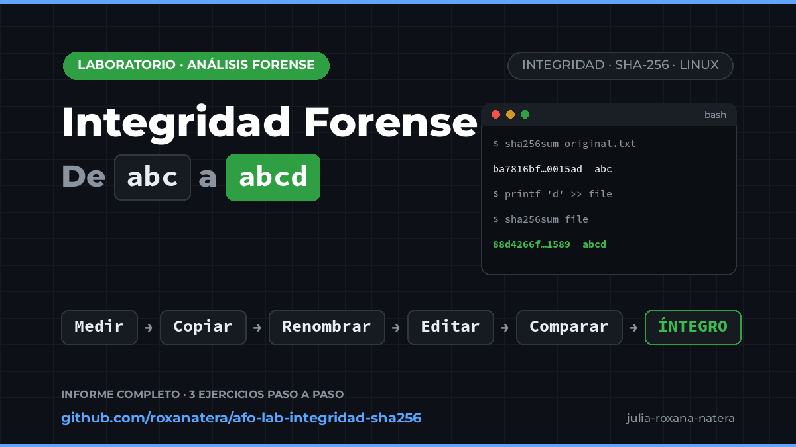
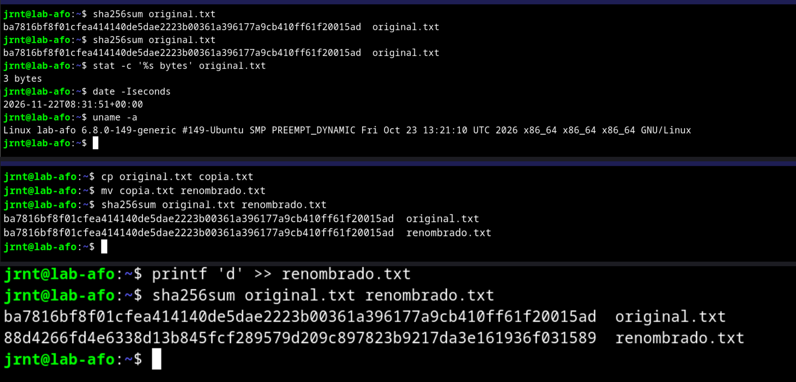
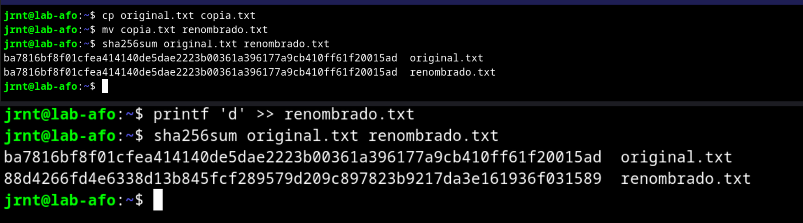

# 🔐 AFO Lab · Integridad forense con SHA-256



Laboratorio práctico del módulo **Análisis Forense Informático (AFO)**, Sesión 3: *Principios de adquisición e integridad*. El ejercicio demuestra, con comandos GNU/Linux reproducibles, qué verifica exactamente un hash SHA-256 al copiar, renombrar y modificar un archivo — y qué NO verifica.

| Sesión | Módulo | Sistema | Herramientas |
|---|---|---|---|
| S3 · Adquisición e integridad | AFO | Ubuntu Linux (lab-afo) | GNU Coreutils: `sha256sum`, `stat`, `cp`, `mv`, `printf` |

---

## 🎯 Objetivos

1. **Calcular y registrar** una referencia de integridad completa: objeto, tamaño en bytes, algoritmo, valor completo, momento con zona horaria, comando y sistema.
2. **Verificar** que copiar y renombrar un archivo conserva su contenido.
3. **Detectar** la modificación de un archivo mediante el cambio de su hash.
4. **Documentar** con rigor forense: predicciones previas a la ejecución, registros completos y conclusiones limitadas a los datos.

## 🛠️ Reproducción

```bash
# Entorno de trabajo
mkdir practica_hash_afo && cd practica_hash_afo

# [Ej. 6] Archivo de prueba: los 3 bytes de "abc", sin salto de línea
printf 'abc' > original.txt

# Doble cálculo de la referencia SHA-256 + metadatos del registro
sha256sum original.txt
sha256sum original.txt
stat -c '%s bytes' original.txt
date -Iseconds

# [Ej. 7] Copiar, renombrar y verificar
cp original.txt copia.txt
mv copia.txt renombrado.txt
sha256sum original.txt renombrado.txt

# [Ej. 8] Modificar la copia y comprobar el cambio
printf 'd' >> renombrado.txt
sha256sum original.txt renombrado.txt
```

## 📊 Resultados — Sesión 3, Ejercicios 6–8

| Archivo | Contenido | SHA-256 |
|---|---|---|
| `original.txt` | `abc` (3 bytes) | `ba7816bf8f01cfea414140de5dae2223b00361a396177a9cb410ff61f20015ad` |
| `renombrado.txt` (antes) | `abc` (3 bytes) | `ba7816bf8f01cfea414140de5dae2223b00361a396177a9cb410ff61f20015ad` ✅ idéntico |
| `renombrado.txt` (después) | `abcd` (4 bytes) | `88d4266fd4e6338d13b845fcf289579d209c897823b9217da3e161936f031589` ❌ cambiado |

El hash obtenido coincide con el ejemplo canónico de SHA-256 sobre los bytes `61 62 63` documentado en **FIPS 180-4**, lo que valida el procedimiento completo.

### Capturas de la ejecución (Sesión 3)

**Ejercicio 6 — Doble cálculo de la referencia, tamaño, momento y sistema:**



**Ejercicios 7 y 8 — Copiar/renombrar conserva el hash; añadir un byte lo cambia:**



## 🔑 Lecciones forenses

- **El hash es determinista y verifica contenido, no más:** una coincidencia significa "no se detectó diferencia respecto a la referencia con este método". No acredita procedencia ni autenticidad.
- **Copiar y renombrar no cambia el hash del contenido:** `cp` + `mv` conservan los bytes; el nombre no forma parte del contenido.
- **Un solo byte cambia el digest:** de `abc` a `abcd` el hash pasa de `ba7816...` a `88d426...`.
- **La referencia no se actualiza silenciosamente:** si archivo y manifiesto se modificaran a la vez, la verificación perdería su valor. Los valores anterior y posterior se conservan y se documenta el cambio.
- **El hash no cubre metadatos externos** (nombre, marcas temporales del sistema de archivos). En una imagen de almacenamiento completa, esos metadatos sí quedarían dentro del ámbito de bytes calculado.
- **MD5 y SHA-256 no son comparables entre sí:** son algoritmos distintos con valores no intercambiables.

## 📄 Documentación

- [`docs/Informe_AFO_S3_Ejercicios_6-8.pdf`](docs/Informe_AFO_S3_Ejercicios_6-8.pdf) — informe formal con predicciones, registros completos de integridad y conclusiones acotadas al método empleado.

---

*Práctica realizada en entorno de laboratorio con datos de prueba, sin soportes reales ni datos personales.*
